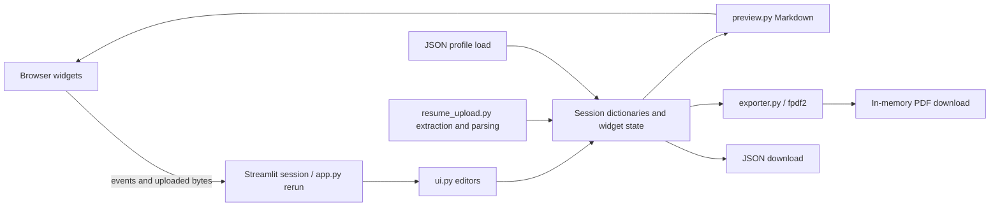

# Resume Builder — Production Readiness Audit

Audit date: **13 November 2026 (Asia/Calcutta)**  
Requested repository: [pranavrmkr/ResumeBuilder, integration/team-features](https://github.com/pranavrmkr/ResumeBuilder/tree/integration/team-features)

## 1. Executive Summary

**Assessment: suitable for a small, supervised prototype; not ready for a broad production launch.** Basic editing, section navigation, manual JSON backup/restoration, and Latin-1 PDF export work in the exercised journeys. Passing tests do not cover important failures in recovery, import integrity, international text, preview fidelity, or document layout.

### Audited revisions and an important scope distinction

Two different revisions exist:

| Label | Exact revision | Meaning |
| --- | --- | --- |
| **R — linked branch** | `c24604c75a7e9242b11934b8489b7d50b52b040c` | Remote `integration/team-features`, verified with `git ls-remote origin refs/heads/integration/team-features` during this audit. |
| **L — local checkout** | `96c9caff2cfbf6d870711b3d95894938b95ad4c8` | Current workspace on the same branch name; two commits ahead of R: `120915b` and `96c9caf`. |

The local commits add full-section resume parsing, preview corrections, and a warm light theme. **Those changes are not present at the supplied GitHub branch tip.** This report covers both revisions and marks their differences. R was extracted from existing Git objects into an isolated temporary snapshot and tested independently; the active checkout was not switched or reset.

Unless explicitly prefixed **R**, `file.py:line` references below refer to **L**. Shared exporter/model files have the same line numbers in both revisions. For R, use the revision-specific anchors provided beside findings. Repository paths are relative to the repository root. Immutable source: [R tree](https://github.com/pranavrmkr/ResumeBuilder/tree/c24604c75a7e9242b11934b8489b7d50b52b040c).

### Highest-priority findings

| Finding | Scope | Severity | Production significance |
| --- | --- | --- | --- |
| D13: partially parsed imports replace complete existing sections without a recovery snapshot | L only | High | Existing entries can be lost while the importer reports success. |
| D01: drafts disappear after a browser refresh/new session | R + L | High | Manual JSON download is the only durable backup; ordinary user work is not recovered automatically. This limitation is documented. |
| D02: valid non-Latin names cannot be exported | R + L | High | The primary deliverable is unavailable for many users despite successful editing and JSON storage. |
| D03: deeply nested JSON escapes error handling | R + L | Medium | A roughly 20 KB malformed profile can abort the current app execution with `RecursionError`. |
| D05–D09: preview/PDF discrepancies and PDF layout defects | R + L, with local preview fixes noted | Medium | Currency symbols, bullets, empty sections, typography, and page boundaries are unreliable. |
| S01–S02: insufficient resource budgets and dependency reproducibility | R + L | High risk, conditional exposure | Important before hosting untrusted uploads; no deployed resource-exhaustion exploit or current dependency exploit was demonstrated. |

There are **18 numbered confirmed findings**, including documented product limitations and one linked-only preview issue already fixed locally. They are not all independent release blockers. Potential risks and deployment-dependent security concerns are listed separately. No confirmed Critical vulnerability or cross-session disclosure was established.

### Verification performed

- Read every tracked application module, test module, dependency declaration, README, and configuration file in L; inspected the complete R-to-L diff and the changed R source. Inventoried all tracked files in both revisions.
- Executed the existing suites: **R: 6 tests passed**, **L: 8 tests passed**.
- Executed additional bounded synthetic probes using the installed dependencies, including AppTest callbacks, malformed profiles, session isolation, PDF text extraction, large fields, parser ambiguity, destructive partial import, and PDF invalidation after editing.
- Inspected the running R and L applications in the in-app browser. Checked mobile at **390 × 844**, desktop at **1440 × 1000**, live editing, navigation, and L refresh behavior.
- Inspected rasterized in-memory exporter output with installed PDFium and extracted PDF coordinates/text with pdfplumber. Confirmed duplicate bullets, crowded header text, empty sections, and an orphaned section heading visually.
- Ran `pip check`, Python AST syntax validation, a limited tracked-file secret-pattern scan, and targeted primary-source advisory checks.

No existing application source, dependency, test, or configuration was modified. No additional package was installed. Initial sandboxed Streamlit commands stalled and loopback access was denied; those attempts were stopped, and the relevant commands succeeded outside the restricted sandbox. These environment failures are not attributed to the product. Both audit servers were stopped afterward.

### Limits of the assessment

No deployed application URL, hosting configuration, reverse proxy, production logs, service account permissions, or real-user traffic was supplied. There was no comprehensive SCA scan, penetration test, assistive-technology certification, ATS vendor test, mobile-device test, or Safari/Firefox verification. Browser tests used Chromium through the in-app browser. Upload callback tests use synthetic `BytesIO` inputs; they do **not** prove browser file-picker/upload transport correctness. Performance figures are small local microbenchmarks, not production latency or capacity guarantees. No claim of overall security or full accessibility conformance is made.

## 2. Technology Stack and Architecture Overview

### Complete tracked file inventory

```text
ResumeBuilder/
├── .gitignore
├── .streamlit/config.toml       # L only
├── README.md
├── requirements.txt
├── app.py                      # Composition, state, JSON load/save, PDF action
├── models.py                   # Three dataclasses
├── ui.py                       # Editors; L also injects local CSS
├── preview.py                  # Markdown projection
├── exporter.py                 # fpdf2 document renderer
├── resume_upload.py            # Extraction/contact parser; L adds section parser
├── styles.css                  # L only
├── test_app.py
├── test_integration.py
└── test_resume_upload.py
```

R has **12 tracked files**; L has **14**. L contains **six application Python modules** and **three test modules**. There are no tracked REST controllers, migrations, database files, frontend package manifests, container definitions, deployment manifests, CI workflows, or lockfiles. Pre-existing untracked `output/` and `samples/` directories were inventoried and left untouched; they are not part of the linked revision and were not treated as shipped application features. Ignored bytecode is generated runtime output, not redundant source.

### Dependencies and runtime

| Layer | Implementation/evidence | Installed audit version |
| --- | --- | --- |
| Runtime | README requires Python 3.10+ | Python 3.12.10 |
| UI and application server | `streamlit>=1.66.1,<2`, `requirements.txt:2` | 1.66.1 |
| PDF input/text extraction | `pdfplumber>=0.11,<0.12`, `requirements.txt:3`; `resume_upload.py:17–19` | 0.11.10 |
| PDF output | `fpdf2>=2.8,<3`, `requirements.txt:4`; `exporter.py:1` | 2.9.0 |
| PDF input parser underneath pdfplumber | Installed package metadata | pdfminer.six 20260107 |
| State | `st.session_state` dictionaries and widget keys | Per Streamlit session |
| Serialization | Python `json` | Standard library |
| Models | Python `dataclasses`; UUID entry identifiers | Standard library |
| Styling | Streamlit defaults in R; `.streamlit/config.toml` and `styles.css` in L | No separate frontend build |
| Tests | `unittest`, `streamlit.testing.v1.AppTest`, pdfplumber | Already installed |

All three direct dependencies are used. No unnecessary direct dependency was identified. Streamlit brings a substantial transitive stack, but its packages cannot simply be removed as unused imports in this application.

### Execution architecture



The browser and Python server communicate through Streamlit's transport and widget system. There is **no application-defined public REST API**. JSON profile loading is a Python callback, not an API endpoint. Likewise, a resume upload triggers a callback in the current session, not a separate extraction service.

The architecture is a small server-rendered Python application. It does not have independent JavaScript frontend state, a separate backend service, a database, an ORM, SQL queries, account relationships, payment services, AI providers, or analytics integrations in tracked code.

### Domain shape and ordering

`models.py:5–32` defines `PersonalInfo`, `Education`, and `Experience`; all attributes default to empty strings. Education and experience are dictionaries keyed by UUID hex strings. Their dictionary insertion order determines display/export order. There is no explicit section order, entry position, resume identifier, owner identifier, or revision number.

`app.py:305–316` emits `format_version: 1`, personal information, education, and experience. It does not save the PDF color theme or document layout settings. `normalise_profile()` accepts only the three top-level dictionary shapes, fills defaults, discards unknown fields, and coerces values to strings. It does not dispatch on the emitted format version.

## 3. Complete Application Functionality Breakdown

### User journey traced through actual code

| Stage | Actual execution and persistence | Evidence / verification |
| --- | --- | --- |
| Open application | Sets page configuration, initializes three dictionaries; L loads local CSS and masthead. | `app.py:12–25`; `ui.py:10–11`. Both revisions launched successfully. |
| Enter personal data | Seven widgets: name, headline, email, phone, location, website, summary. The rendered widget values replace the canonical personal dictionary during each rerun. | `ui.py:14–30`; R `ui.py:9–25`. Live edit and return-navigation tests pass. |
| Add education | Adds a UUID-keyed default record and requests another rerun. All records on the active editor are rendered as six widgets each. | `ui.py:33–58`; R `ui.py:28–53`. |
| Add experience | Same pattern for jobs, with newline-separated achievements. | `ui.py:61–86`; R `ui.py:56–81`. |
| Edit entries | Keyed widgets write into the canonical dictionary; dataclass reconstruction restores expected shape. There is no explicit Save action for form editing. | `ui.py:55–58,83–86`. Navigation survival exercised by existing tests. |
| Remove entries | Deletes the selected dictionary record and reruns immediately. There is no undo or recovery snapshot. | `ui.py:43–45,71–73`; R lines 38–40,66–68. |
| Change sections | Sidebar radio conditionally renders one editor. Canonical dictionaries preserve data after Streamlit cleans up widgets that are no longer rendered. | `app.py:169–172,264–286`; R lines 158–161,253–273. |
| Preview | Always generates Markdown from all canonical sections; the Preview radio option replaces the editor with an informational message. It does not switch to a PDF proof. | `preview.py:8–49`; `app.py:281–302`. |
| Import PDF/TXT | Reads bytes in memory; PDF text is extracted on every page, TXT uses UTF-8-sig or BOM-detected UTF-16. Callback occurs on upload change, so later edits are not overwritten on every rerun. | `resume_upload.py:13–33,155–192`; R lines 9–29,62–80. |
| Import scope in R | Only guesses name, email, and phone from extracted text. Existing other data remains. Education/experience import is explicitly absent. | R `resume_upload.py:32–79`; R README. This is a capability limitation, not a broken promised section-import feature. |
| Import scope in L | Splits headings; imports contact information and summary; replaces each successfully parsed education/experience section. Unrecognized sections are not stored. | `resume_upload.py:66–191`. Partial replacement/data integrity defects are detailed below. |
| Save profile | Builds JSON after the active form has updated state, then exposes a sidebar download. This is a user-triggered download, not autosave. | `app.py:305–325`; R lines 292–312. Current-value assertion passes. |
| Load profile | UTF-8 decode → `json.loads` → normalize all sections → replace canonical dictionaries → seed widget keys → success message. Validation occurs before normal replacement. | `app.py:86–146`; R lines 84–144. Malformed ordinary JSON preserves the prior draft in tests. |
| Choose appearance | Selects one of five PDF text colors. There is only one PDF layout; changing this option does not recolor the Markdown preview. R includes Elegant Purple; L replaces it with Burnt Amber. | `app.py:229–247`; R lines 218–236. |
| Generate PDF | Requires only a nonblank name, then renders A4 with Helvetica and stores `(bytes, JSON snapshot, theme)` in session state. Errors become an inline error message. | `app.py:337–370`; R lines 323–356; `exporter.py:52–329`. |
| Download PDF | Download remains available only while the current serialized resume and color match the stored snapshot. Editing or changing color removes it. | `app.py:372–378`; R lines 358–364. Theme invalidation and edit invalidation verified. |
| Clear data | Clears the entire session and increments a resume-uploader version, resetting forms, messages, and generated PDF. No recovery path exists. | `resume_upload.py:195–198`; R lines 83–86. Existing clear tests pass. |
| Refresh/reconnect | No application storage is read at startup; a new session starts blank. L browser reload returned the edited name to the placeholder. | `app.py:23–25`; `README.md:20–22`. |

### Capabilities that are absent

There is no skills editor, projects editor, certifications editor, custom sections, template gallery, entry reordering, multi-resume library, account login, server-side resume retrieval, cloud autosave, version history, DOCX export, sharing links, job matching, cover-letter generation, OCR, or AI assistance. The current live preview, multiple entries, manual JSON backup/restore, PDF download, color choices, and PDF/TXT import must not be proposed as if they were entirely missing.

## 4. Confirmed Bugs and Defects

**Evidence labels:** “runtime” means reproduced with browser/AppTest/helper execution; “source” means a deterministic implementation behavior was inspected; “documented limitation” distinguishes intended restrictions from accidental regressions. Severity describes impact; the roadmap separately assigns implementation priority.

### D01 — A refresh loses an unsaved draft

- **Scope/status:** R + L; runtime confirmed, documented persistence limitation. **Severity: High.**
- **Location/component:** `app.py` module-level session initialization and profile download, `app.py:23–25,305–325`; R `app.py:21–23,292–312`; `README.md:20–22`.
- **Reproduce:** Start a session, enter a name and other details, do not download JSON, and reload the browser. L returned to empty name/“Your name.” A fresh independent session is also empty.
- **Cause/impact:** Only session memory stores the draft. No startup recovery, durable write, or in-product unsaved-state warning exists. Manual JSON backup can prevent loss, but requires the user to anticipate a session reset. A brief disconnect need not immediately erase everything; the confirmed scenario is a reload/new session.
- **Recommendation:** Show the persistence limitation prominently now; implement explicit, privacy-aware recovery/autosave and a visible saved indicator. Do not write all users into one shared JSON file. Add refresh/restart recovery acceptance tests.

### D02 — Non-Latin user content prevents the main PDF export

- **Scope/status:** R + L; runtime confirmed, documented restriction. **Severity: High.**
- **Location/functions:** `clean_text()` and `generate_resume_pdf()` / nested `write_text()`, `exporter.py:4–31,105,156–160`; module-level PDF action, `app.py:355–370`; R action at `app.py:341–356`.
- **Reproduce:** Use `अर्जुन`, `李明`, or `Alex 🚀` as the full name and generate PDF. Each fails with the Latin-1-only error. `José García` succeeds.
- **Cause/impact:** `clean_text()` explicitly rejects characters outside Latin-1 and the renderer uses core Helvetica. Valid names and achievements accepted in forms/JSON cannot be delivered as PDFs. This is a handled export failure, not an uncaught application crash. Asking users to change their names to Latin spellings is inadequate for a general product.
- **Recommendation:** Embed properly licensed Unicode fonts with tested fallback coverage. Add shaping support for scripts that need it; font embedding alone does not guarantee correct Indic/RTL rendering. Validate representative names, extraction order, and PDF appearance.

### D03 — Deep JSON nesting bypasses profile error handling

- **Scope/status:** R + L; runtime confirmed in L; the relevant callback/exception list is identical in R apart from line offsets. **Severity: Medium.**
- **Location/function:** `load_saved_profile()`, `app.py:93–97,135–141`; R `app.py:91–95,133–139`.
- **Reproduce:** Feed the load callback UTF-8 bytes for `'[' * 10000 + '0' + ']' * 10000` through the same synthetic upload harness used by existing integration tests. AppTest records `maximum recursion depth exceeded while decoding a JSON array from a unicode string`.
- **Cause/impact:** `json.loads()` can raise `RecursionError`, which is absent from the handled exceptions. Current execution aborts instead of displaying the expected controlled error. The existing draft remained in state in the probe; no global server crash or cross-user effect was demonstrated.
- **Recommendation:** Add a modest byte budget, schema/depth policy, and a controlled `RecursionError` path. Keep the prior draft on all decoding/validation errors. Test through actual upload transport as well as the callback.

### D04 — Profile validation accepts unsupported versions and structured field values

- **Scope/status:** R + L; runtime confirmed. **Severity: Medium.**
- **Location/functions:** `normalise_profile()` / nested `clean_entries()` and `load_saved_profile()`, `app.py:30–81,95–106`; module-level serialization at lines 305–309; R `app.py:28–79,93–104,292–296`.
- **Reproduce:** Load a structurally valid profile with `format_version: 999` and `summary: {"invalid": "object"}`. Loading reports success; summary becomes the Python dictionary representation. A zero/false value becomes an empty string through `value or ""`.
- **Cause/impact:** The loader ignores `format_version` and coerces arbitrary JSON values with `str()`. Unknown fields are silently dropped. A future profile can therefore be accepted and re-saved after losing unsupported data. The scalar coercion keeps many ordinary invalid types from crashing preview, but is not semantic validation.
- **Recommendation:** Introduce explicit supported-version dispatch, documented legacy handling, string-only field schemas, bounded IDs/entry counts/field lengths, and field-specific errors. Reject unsupported future versions before state mutation.

### D05 — Dollar-denominated achievements lose literal dollar signs in the preview

- **Scope/status:** R + L; browser confirmed in both. **Severity: Medium.**
- **Location/function:** `plain_text()`, `preview.py:4–5`; render call `app.py:296–302`, R `app.py:283–289`.
- **Reproduce:** Enter `Raised $10M and saved $2M per year.` as summary. The input retains both dollar signs; the browser preview's rendered paragraph reads `Raised 10M and saved 2M per year.` and styles the intervening text differently. The PDF path does not use this Markdown conversion.
- **Cause/impact:** `plain_text()` escapes many Markdown characters but omits dollar delimiters. Streamlit Markdown supports mathematical syntax, so resume text is interpreted rather than reliably shown literally. Other Streamlit-specific shortcodes also warrant regression cases. This is a presentation-integrity issue; it is not evidence of JavaScript execution.
- **Recommendation:** Escape the complete supported markup surface for user text, or render user strings as text nodes in a controlled document view. Preserve intentional document headings/list structure separately. [Streamlit Markdown behavior](https://docs.streamlit.io/develop/api-reference/text/st.markdown).

### D06 — Export adds a second bullet marker to pasted achievements

- **Scope/status:** R + L; PDF text and visual confirmation. L preview already corrects common markers; R preview still duplicates them. **Severity: Medium.**
- **Location/functions:** `generate_resume_pdf()` achievement loop, `exporter.py:311–323`; `resume_markdown()`, R `preview.py:45–47`; L `preview.py:45–47` contains a partial preview-only remedy.
- **Reproduce:** Enter `- Built reliable services` and `• Mentored engineers` on separate achievement lines. Exported PDF text contains `- - Built reliable services` and `- - Mentored engineers`; the L live preview shows single bullets.
- **Cause/impact:** The exporter blindly prepends `- ` after converting Unicode bullets to hyphens. Normal pasted resume content becomes visibly untidy and differs from the local preview.
- **Recommendation:** Normalize bullet text once in a shared presentation model and let each renderer add exactly one marker. Retain meaningful internal hyphens and test hyphen, star, Unicode bullet, blank lines, and indentation cases.

### D07 — Fixed PDF line height is too small for the name font

- **Scope/status:** R + L; visually and geometrically confirmed. **Severity: Medium.**
- **Location/functions:** `generate_resume_pdf()` / nested `write_text()`, `exporter.py:90–119,156–167`.
- **Reproduce:** Export `Alex Smith` with headline `Senior Engineer`. The header lines are visibly crowded. pdfplumber gives the name word bounds at y=41.594–63.594 pt and headline bounds at y=61.187–72.187 pt: their bounding boxes overlap vertically by about **2.407 pt**.
- **Cause/impact:** `write_text()` advances every font size by 5 mm, even for the 22 pt name. Long names wrapping onto multiple lines make the inappropriate line spacing more apparent. The exact visible glyph collision depends on characters; overlapping text boxes and insufficient leading are confirmed.
- **Recommendation:** Derive leading from font size, give the name/header a dedicated layout, and include explicit spacing before the headline/contact block. Add multi-line-name visual fixtures.

### D08 — A section heading can be stranded at the foot of a page

- **Scope/status:** R + L; PDF text and visual confirmation. **Severity: Medium.**
- **Location/functions:** `generate_resume_pdf()` / nested `section_title()` and entry rendering, `exporter.py:124–151,209–261,266–326`.
- **Reproduce:** Set summary to 46 newline-separated `A short summary line.` strings, with one education entry containing degree `BSc` and institution `Example University`. The first page ends with `EDUCATION`; the degree and institution start page 2.
- **Cause/impact:** Automatic page breaks operate on individual drawing calls. There is no keep-with-next policy for a section heading and first entry. This damages professional document quality and makes multi-page resumes difficult to proof from the current preview.
- **Recommendation:** Reserve enough space for a heading plus the first meaningful content block using the PDF library's layout facilities or explicit height measurement. Keep short entry headers together while allowing long descriptions to split safely.

### D09 — Empty records render phantom sections or placeholders

- **Scope/status:** R + L; runtime confirmed. L fixes the Markdown half only. **Severity: Medium.**
- **Location/functions:** `generate_resume_pdf()`, `exporter.py:209–211,266–268`; `resume_markdown()`, R `preview.py:10–16,29–35,39–42`; L filtering at `preview.py:12,16`.
- **Reproduce:** Enter a name, click Add degree, leave every degree field empty, then export. PDF includes `EDUCATION` with no entry. In R the live preview also includes `Education` and a placeholder `Degree`; L hides the empty section in preview but still exports its heading. Jobs behave analogously by inspection of the same pattern.
- **Cause/impact:** The exporter checks dictionary truthiness rather than whether entries have substantive text. Preview/export use different rules locally.
- **Recommendation:** Use one shared predicate for substantive entries. Decide whether incomplete entries are excluded with a warning or require completion; apply that decision consistently across preview, JSON, and PDF.

### D10 — Contact heuristics can import the wrong name or a date as a phone

- **Scope/status:** R + L; helper execution confirmed. **Severity: Medium.**
- **Location/function:** `parse_resume_text()`, `resume_upload.py:36–63`; R `resume_upload.py:32–59`.
- **Reproduce:** `Software Engineer\nAlex Smith\nalex@example.com` yields name `Software Engineer`. `Alex Smith\n202001 - 202412` yields phone `202001 - 202412`.
- **Cause/impact:** The first name-shaped line wins, and any number-shaped match containing 10–15 digits can win as phone. Neither rule considers labels, contact context, or date patterns sufficiently. Imports can overwrite previously correct fields.
- **Recommendation:** Prefer explicit labels and contact blocks, reject date-shaped candidates, expose low-confidence suggestions, and require review before replacing a populated field. Include decomposed accents and non-Western name conventions in fixtures; avoid restrictive “real name” validation.

### D11 — Export accepts semantically invalid contact and date fields

- **Scope/status:** R + L; invalid-email export confirmed; absence of date/URL validation confirmed in source. **Severity: Medium.**
- **Location/functions:** `personal_info_form()`, `education_form()`, `experience_form()`, `ui.py:16–29,46–57,74–85`; R equivalent forms at lines 11–24,41–52,69–80; module-level export validation, `app.py:345–349`, R lines 331–335.
- **Reproduce:** Enter a valid name and email `definitely-not-email`; Generate PDF succeeds with zero warnings/errors in the exercised case. Enter an end date before a start date or an arbitrary website string: no form validation is performed.
- **Cause/impact:** Only the full name is checked before exporting. Users can send resumes with broken contact details or inconsistent dates without feedback.
- **Recommendation:** Add field-specific, non-destructive validation and a pre-export review. Allow flexible international phone/address formats and “Present”; treat unparseable free-form dates carefully rather than erasing them. Use warnings for optional fields and clear blocking rules only where justified.

### D12 — Education line breaks collapse in the linked branch preview

- **Scope/status:** R only; deterministic Markdown generation confirmed; fixed in L. **Severity: Low.**
- **Location/function:** `resume_markdown()`, R `preview.py:38`; L fix at `preview.py:38`.
- **Reproduce:** Use education details `First detail\nSecond detail`. R passes a soft newline into a Markdown paragraph, which does not request a visible hard line break. PDF preserves separate lines. L joins these lines with Markdown hard-break syntax.
- **Impact/recommendation:** Lists/details entered on separate lines can appear as one paragraph in R. Carry the existing L fix forward and add an assertion against rendered browser line breaks, not only the Markdown string. [Streamlit Markdown line-break examples](https://docs.streamlit.io/develop/api-reference/text/st.markdown).

### D13 — Partial section import irreversibly replaces a more complete draft

- **Scope/status:** L only; AppTest confirmed. **Severity: High.**
- **Location/functions:** `parse_entries()` and `import_uploaded_resume()`, `resume_upload.py:123–126,164–167,179–191`.
- **Reproduce:** Start with two existing degrees. Import text containing `Alex Smith`, an `Education` heading, a labeled `Institution: Valid University` / `Degree: New degree` block, then a blank line and `Other University\nUnrecognized undated qualification`. Exactly one block is parsed. Both old degrees are replaced with that one record, the undated block disappears, and the message is **success**: `Imported full name, 1 education entries...`.
- **Cause/impact:** Any nonempty parsed result replaces the entire section. The parser drops unparseable blocks, while the warning logic only detects a wholly empty section parse. There is no backup or undo. README documents replacement, but the combination of partial parsing, silent block loss, and successful status leaves the user unable to recover prior data in-app.
- **Recommendation:** Parse into a staging result containing candidates, rejected blocks, and diagnostics. Show a before/after comparison with merge/replace choices; create an undo snapshot before applying any replacement. A partially recognized section must not be reported as fully successful.

### D14 — Mixed labeled/unlabeled imports misclassify dates, roles, and institutions

- **Scope/status:** L only; helper execution confirmed. **Severity: Medium.**
- **Location/function:** `parse_entries()`, `resume_upload.py:109–150`, particularly the `if not any(entry.values())` branch at line 122.
- **Reproduce:** Parse `Company: Example Co\nDeveloper\n2020 - Present\nBuilt tools` as experience. Company is populated, but role/start/end are empty and those remaining lines become achievements. `Degree: BSc\nExample University\n2020 - 2024` similarly puts institution and dates into details.
- **Cause/impact:** Recognizing even one labeled value disables all positional/date inference for that block. Real resumes often combine a labeled company/degree with unlabeled date ranges. A plausible-looking import silently contains incorrect structure.
- **Recommendation:** Infer missing fields independently, retain provenance, and flag contradictory evidence. Add mixed-format fixtures and never convert recognized date lines to achievement prose merely because another field had a label.

### D15 — Multi-entry text and extra pre-date lines are silently merged or discarded

- **Scope/status:** L only; helper execution confirmed. **Severity: Medium.**
- **Location/function:** `parse_entries()`, `resume_upload.py:100–103,123–147`.
- **Reproduce:** Two unlabeled jobs separated only by newlines are treated as one block: the second company/title/date become achievements of the first job. In a block with four pre-date lines, `dict(zip(order, before))` keeps only the first three; a fourth line such as department disappears.
- **Cause/impact:** Blank lines define entry boundaries and positional assignment uses a fixed three-field list. PDF `extract_text()` does not guarantee preservation of the visual whitespace used to separate entries. The README does require blank lines for text imports, but a PDF uploader cannot ensure that extraction produces them.
- **Recommendation:** Detect repeated date/title/company clusters, preserve unassigned lines, and report unmatched content explicitly. Use a reviewed corpus of extracted PDFs. Do not market arbitrary PDF imports as complete structured restoration; JSON already serves that purpose.

### D16 — Importing the application's own PDF produces contaminated or missing fields

- **Scope/status:** L only for structured section import; runtime confirmed. **Severity: Medium.**
- **Location/functions:** `resume_sections()` and `parse_entries()`, `resume_upload.py:66–86,139–147`; `ResumePDF.footer()` and `generate_resume_pdf()`, `exporter.py:36–49,198–204,278–323`.
- **Reproduce:** Export a profile with summary, education, and job title `Sales Associate` at `Engineering Solutions`; extract/import that PDF. `PROFESSIONAL PROFILE` is not a recognized summary alias, so no summary is parsed. The job becomes company `Sales Associate`, job title `Engineering Solutions`, and achievements include `Page 1`.
- **Cause/impact:** Renderer headings and parser aliases differ, title/company order is guessed by a limited profession keyword regex, and generated footers are not removed. An already present summary may misleadingly survive from the old draft instead of coming from the new file. This also affects other PDFs with similar structure. Exact PDF round-trip restoration is not promised, but contamination with footer text is a reproducible quality defect.
- **Recommendation:** Share known heading aliases, strip confidently identified page furniture, avoid profession-list guessing as the sole ordering signal, and expose ambiguities. Continue to distinguish best-effort PDF import from exact JSON restoration.

### D17 — Unrecognized section headings leak into neighboring imported content

- **Scope/status:** L only; helper execution confirmed. **Severity: Medium.**
- **Location/functions:** `resume_sections()` and `parse_entries()`, `resume_upload.py:67–85,118–119`.
- **Reproduce:** After `Experience`, use `Company: Example Co`, `Job title: Developer`, `Achievements: Built APIs`, then `Awards` and `Best engineer`. The heading and award text are appended to the job's achievements because Awards is not a recognized section boundary. Similar boundary ambiguity applies to unlisted headings.
- **Cause/impact:** The section splitter recognizes a short fixed set; unfamiliar headings continue the current section. This can incorrectly attribute unrelated qualifications to a job, and a summary can absorb later unsupported content.
- **Recommendation:** Expand and normalize heading detection, retain unknown sections as reviewable blocks, and show import diagnostics. Do not silently delete unsupported content or indiscriminately treat every capitalized line as a heading.

### D18 — Local accent text narrowly fails normal-text contrast requirements

- **Scope/status:** L only; deterministic color calculation from CSS. **Severity: Low.**
- **Location/component:** accent, eyebrow, and primary-button CSS rules, `styles.css:6,38–45,69–84`; `.streamlit/config.toml:3`.
- **Reproduce/evidence:** Relative-luminance calculations give accent `#c45530` on page `#fcfbf9` **4.3303:1** and white `#ffffff` on primary-button accent **4.4783:1**. These normal-size text styles fall below 4.5:1. Muted text `#736d63` on the page measures 4.9568:1 and does not fail this calculation.
- **Impact/recommendation:** Small labels and primary-button text have insufficient nominal contrast. Slightly darken the accent and test actual default/hover/focus/disabled styles. Do not round 4.4783 up to a pass. This is a narrow finding, not an assertion that all accessibility criteria were audited. [W3C contrast criterion and threshold guidance](https://www.w3.org/WAI/WCAG22/Understanding/contrast-minimum.html).

## 5. Potential Bugs and Edge Cases

These are **not claimed as reproduced failures** unless a narrower confirmed result is explicitly referenced. Each needs a focused validation exercise.

| ID / severity | Condition and location | Potential consequence | Recommended validation/remedy |
| --- | --- | --- | --- |
| R01 — High | Concurrent large PDFs; `resume_upload.py:14–19` (R lines 10–15), unconfigured `server.maxUploadSize` | Memory/CPU exhaustion can affect other sessions. Local default upload cap is 200 MB; extraction walks all pages without an application page/text/time budget. | Use bounded local load tests with process monitoring. Add small per-type upload limits, page/text caps, concurrency limits, and process-level isolation/timeouts. No hostile exhaustion payload was run. |
| R02 — Medium | Very large JSON entry counts/strings; `app.py:61–69,95–97`; all active-entry widgets in `ui.py` | Huge widget trees, repeated serialization, slow reruns, and memory amplification. | Bound entry counts and field/ID length. Benchmark active editor behavior separately from helper functions. A 300-character name and 5,000-character summary exported without a crash, but that is not a general bound. |
| R03 — Medium | Scanned, encrypted, malformed, rotated, multi-column, or mixed-language PDFs; `resume_upload.py:17–32` | Extraction may fail or read in an incorrect order. Empty/malformed-file paths are tested; complex layout/OCR accuracy is not. | Use a fixture corpus and present readable import diagnostics. Treat encrypted PDFs and image-only documents explicitly; defer OCR until ordinary import integrity is solved. |
| R04 — Medium | Rapid editing followed by download/navigation; widgets lack `on_change` domain callbacks, `app.py:312–325,337–378` | A pending browser edit might not have reached canonical state before a download event. Ordinary committed edits work in the tests; no stale-download race was reproduced. | Browser E2E tests for blur, Enter, click download while focused, rapid field changes, slow network, and theme changes. Prefer an explicit committed snapshot. |
| R05 — Medium | Multiple tabs/reconnects/process restart/load-balanced replicas | Users may expect a shared draft; server-local uploads/downloads and state need session affinity. | Test the chosen deployment, document separate-tab behavior, and design recovery before scaling. The application has no global resume cache, so cross-user state leakage must not be inferred merely from using Streamlit. |
| R06 — Medium | L styles depend on framework-internal DOM/test IDs; `styles.css:9–109` | A permitted Streamlit upgrade can break theming, responsive layout, or focus styling. | Pin/review framework upgrades and run screenshot/keyboard checks at breakpoints; prefer supported theme options. |
| R07 — Low | Long unbroken URLs, names, or Unicode graphemes at narrow sizes; `preview.py:18–47`, L `styles.css:95–109` | Overflow, awkward wrapping, or font fallback differences. | Test 320/390/768/900 px, 200% zoom, long URLs, RTL/CJK, and real mobile browsers. Ordinary 390 px layouts did not show document-level horizontal overflow in the exercised L case. |
| R08 — Medium | Nested structured values converted by `str()`; `app.py:53,67` | Deeply nested valid objects can cause further expensive or surprising conversion; semantically wrong values can look like resume text. | Apply schema checks before coercion; test nested objects/lists and reject with precise errors. D03 covers the separately reproduced JSON decoder failure. |

Specific parser edge cases to add to L's corpus: missing dates, compact numeric dates such as `01/2020`, non-English headings/months, unlabeled roles outside the keyword list, education institution names containing degree-like words, entry titles containing colons, inline `SUMMARY: ...`, repeated headings, bullet continuation lines, and multiple contact candidates. These limitations need measured accuracy and retained unmatched text; they should not be addressed by claiming a regex parser understands arbitrary resumes.

## 6. Security Audit Findings

### Threat model and current trust boundaries

An untrusted browser can submit PDF, TXT, and JSON bytes to the Streamlit process. The app parses those bytes and renders derived strings in the user's own preview/PDF. All parsing currently runs in-process. If hosted publicly without additional controls, anonymous users can exercise those paths. There is no application authentication or authorization layer, but a public, session-only resume tool does not automatically require accounts. A future shared storage feature would create a new authorization boundary.

### S01 — Missing application-level processing budgets

**Severity: High risk for public hosting; source-confirmed missing controls, system-wide exploitability untested.**

The upload widgets (`app.py:179–185,207–213`; R lines 168–174,196–202) specify extensions but no per-widget size cap. Installed Streamlit config reports `server.maxUploadSize = 200` MB. `extract_resume_text()` loads bytes and extracts every page; no page limit, character cap, wall-clock timeout, worker isolation, or rate limiting exists in tracked application code. JSON similarly decodes the entire upload and has no entry budget.

Consequences could include memory pressure, slow request handling, and service degradation under concurrent uploads. A valid small PDF with a very expensive internal structure can also bypass a naive “small file” assumption. No load attack was performed, and hosting-level safeguards could reduce the risk.

**Remedy:** Set deliberate per-format limits in both application and ingress; reject oversized files before parsing, cap pages/extracted characters/entries, limit concurrent extraction, and use a killable low-privilege worker with memory/time budgets for public PDF parsing. Retain useful errors without returning parser internals. D03 is a separate, reproduced bounded-input exception.

### S02 — Dependency policy permits known vulnerable parser versions

**Severity: High conditional risk; manifest weakness confirmed, currently installed parser not affected by the advisories checked.**

`requirements.txt:3` allows the entire pdfplumber 0.11 series. The [upstream changelog](https://github.com/jsvine/pdfplumber/blob/stable/CHANGELOG.md) shows older releases use pdfminer.six versions below 20251230; pdfplumber 0.11.9 moved to 20251230 and 0.11.10 to 20260107. The upstream [crafted-PDF code-execution advisory](https://github.com/pdfminer/pdfminer.six/security/advisories/GHSA-wf5f-4jwr-ppcp) and [CMap deserialization advisory](https://github.com/pdfminer/pdfminer.six/security/advisories/GHSA-f83h-ghpp-7wcc) list affected pdfminer.six versions below 20251230. Exploitation has additional file-path/CMap prerequisites depending on environment; a PDF upload alone must not be represented as a demonstrated exploit here.

Installed pdfplumber **0.11.10** requires pdfminer.six **20260107**, beyond those affected ranges. Installed Streamlit **1.66.1**, as well as the manifest floor 1.66.1, is above the 1.54.0 fix for the checked [Windows SSRF/NTLM advisory](https://github.com/streamlit/streamlit/security/advisories/GHSA-7p48-42j8-8846).

**Remedy:** Raise parser floors to a reviewed fixed combination, lock the complete resolved production environment with hashes, and run an authenticated/current vulnerability audit in CI. Ensure an already installed older permitted pdfplumber cannot satisfy deployment requirements without upgrading. This is not proof of a currently exploitable dependency, and the targeted advisory checks are not a complete SCA report.

### S03 — Error handling can expose internals and fails on recursion

**Severity: Medium for resilience; Low conditional information exposure.**

D03 proves an unhandled load callback exception. `app.py:368–370` also exposes `str(error)` from any PDF exception. The common unsupported-font error is harmless, but future parser/library exceptions can include implementation details. `resume_upload.py:25–30` usefully normalizes most extraction errors; the `ValueError` pass-through can still return raw library text.

**Remedy:** Return stable user-safe error categories and log exceptions with a correlation ID. Do not log uploaded documents, full resume fields, or tokens. Configure production exception visibility explicitly and verify it on the deployed app. No secret-bearing exception was observed.

### Security categories investigated

| Category | Evidence and conclusion |
| --- | --- |
| XSS / generated content | `app.py:296` uses `st.markdown` without `unsafe_allow_html=True`; `preview.py:4–5` escapes common Markdown delimiters. L `st.html` calls contain checked-in CSS/static markup, not interpolated resume values. No executable XSS path was established. D05 demonstrates incomplete **literal-text fidelity**, not an XSS exploit. Rich-content payloads still need browser regression tests. |
| SQL injection | No database driver, SQL statement, ORM, or SQL endpoint exists. SQL injection is not applicable to the current data path. Reassess if storage/search is added. |
| Authentication/authorization | No user accounts, owner checks, custom auth tokens, or private sharing links are implemented. Current drafts are scoped through Streamlit sessions; two independent AppTest sessions did not share the edited name. This is limited evidence, not a multi-user deployment certification. |
| CSRF/CORS | Installed defaults inspected: `server.enableXsrfProtection=True`, `server.enableCORS=True`; tracked configuration does not disable them. Do not flag “missing CSRF middleware” merely because the app does not implement custom middleware. Validate proxy/origin behavior in production. |
| File/path handling | Uploaded bytes are read in memory; the uploaded name is used only to select a suffix. No upload path is constructed for disk writes and no uploaded program is executed. Extension restrictions are not content validation or parser isolation. |
| Unsafe deserialization | Application profiles use `json.loads`, not `pickle`, `eval`, or `exec`. Test modules execute trusted local app source to construct harnesses; this is test coupling, not execution of uploaded JSON. Dependency parser advisories are discussed separately. |
| Secrets | No suspicious credential match in a limited tracked-file pattern scan; `.gitignore:5–6` excludes `.env` and Streamlit secrets. This does not verify ignored files, repository history, external settings, or hosting secrets. No credential values are reproduced in this report. |
| Session/token management | No application-issued authentication token/session cookie logic. Do not invent JWT refresh/revocation defects. Streamlit/session hosting configuration still needs deployment review. |
| Downloads | JSON/PDF are generated from current session data with fixed download names and correct MIME types. No user-controlled server file path is opened for download. No cross-session media-token attack was tested. |
| TLS and deployment headers | Not verifiable without the deployment/proxy configuration. Local loopback HTTP during the audit says nothing about production TLS. |

### Privacy gaps relevant to this product

The UI does not explain that resumes are transmitted to the Python server and stored in session memory, how long hosting retains disconnected sessions, or that manual JSON backups contain personal information in plaintext. README's “not saved to disk” statement is narrower than a privacy guarantee. Streamlit documents uploads as backend memory buffers and session state as tied to the session connection. Add an accurate in-product notice, deliberate retention policy, and a clear distinction between clear-current-session and any future deletion from durable storage. [Upload storage](https://docs.streamlit.io/knowledge-base/using-streamlit/where-file-uploader-store-when-deleted), [session state](https://github.com/streamlit/docs/blob/main/content/develop/api-reference/caching-and-state/session_state.md).

## 7. Code Quality and Maintainability

### Existing structure worth retaining

The separation into models, forms, Markdown projection, importer, and PDF renderer is understandable for the present size. UUID entry keys provide stable widget identities. Ordinary profile validation occurs before state replacement. PDF byte caching is session-scoped and tied to data/theme, avoiding needless regeneration on each rerun. Import runs on file changes rather than overwriting edits on every widget event. These behaviors were exercised; they are not reasons to infer broader readiness.

### Concrete maintainability issues

| Finding | Evidence | Recommended change |
| --- | --- | --- |
| Domain logic is tied to module execution | `app.py:12–378` mixes UI composition, parsing policy, profile serialization, and output handling. Importing `app.py` executes the application. | Extract profile validation/serialization into pure functions, then make `main()` the UI composition boundary. This removes the need for AST extraction or `exec` harnesses to unit-test profile logic. |
| Duplicated field definitions | Dataclasses in `models.py`; labels in `ui.py`; defaults in `normalise_profile`; import aliases in `resume_upload.py`; ordering in both renderers. | Define a small shared schema/metadata table for type, label, multiline behavior, and limits. Keep rendering-specific style outside the schema. |
| Divergent presentation rules | L preview drops blank entries and normalizes bullets; exporter does neither. Headers/summary names also differ. | Introduce a normalized presentation projection with substantive entries, normalized bullets, headings, and explicit order; render it through both outputs. |
| Two state representations require coordination | Canonical dictionaries plus keys like `personal_*` / `education_<id>_*`; callbacks manually seed/reset them. | Centralize `apply_profile` and import application into one adapter. Keep parsing pure and state mutation transactional. Test replacement on every active editor. |
| Type hints are mostly absent | Public helpers in all six application modules; dataclass fields alone do not validate runtime data. | Add signatures for profiles, entries, parser diagnostics, and export results. Type-check after separating UI from domain; retain runtime validation at upload boundaries. |
| Generic broad exception handling loses diagnostics | PDF action catches all exceptions and only prints the message; extractor normalizes exceptions without logging. | Keep safe recovery at the UI boundary and add structured, PII-safe logs. Use expected error types for validation versus internal failures. |
| Historical comments do not describe ownership cleanly | `app.py:201,205,225` uses “PERSON 3” comments; inconsistent vertical spacing obscures a short workflow. | Rename sections around responsibilities and apply one formatter after correctness changes. This is lower priority than behavior fixes. |
| Fragile test control selection | `test_app.py:16,20,25,30,45,52` and uploader tests select some buttons by index. | Give meaningful stable keys to actions and use them. A new button should not silently retarget a test. |
| Test harnesses execute whole app text | `test_integration.py:13–18`, `test_resume_upload.py:50–55,163–170`. | Replace with importable pure services plus `AppTest.from_file` for actual UI integration. Keep targeted callback harnesses where needed and add true browser upload coverage. |

No clearly dead tracked production module or unused direct dependency was found. Education/experience editors have repeated structure, but a small explicit field-driven helper is preferable to a generic dynamic form engine. Exporter's acceptance of either dictionaries or iterables is not used by the current app; narrow/document it rather than calling it an independently confirmed bug.

## 8. Architecture Improvements

### Incremental target architecture

Keep Streamlit for the current product stage. There is no evidence that a React rewrite, microservices, Redis, or a relational database is required to fix the observed bugs.

1. **Extract a versioned domain/profile layer.** Add pure modules such as `profile_schema.py` and `profile_io.py` for validated profiles, schema versions, explicit migrations, stable IDs/order, JSON serialization, and limits. Move `normalise_profile()` out of `app.py`. Preserve compatibility with existing exported version-1 profiles.
2. **Separate parsing from applying changes.** `resume_upload.py` should return an `ImportResult`: candidate values, source spans, unmatched text, confidence, per-block errors, and field replacements. A separate session adapter applies a reviewed result atomically and creates a previous-state snapshot. Extraction failures must not partially mutate a draft.
3. **Create one presentation model.** A small projection should define nonempty sections, normalized bullets, contact fields, and entry order. Markdown and PDF need separate renderers but shared content semantics. Use `exporter.py` for pagination/font/layout policy rather than duplicating those decisions in the UI.
4. **Define draft recovery deliberately.** Begin with in-session undo and an explicit local recovery design. Browser recovery requires supported client-side storage/component integration and consent/retention decisions; arbitrary Python code cannot directly persist into browser storage. For server persistence, use an authenticated owner model and access checks before saving PII. Never use a globally shared “latest resume” file.
5. **Isolate public file processing when hosting warrants it.** Move PDF extraction into a constrained worker only after defining processing budgets and error contracts. A bounded subprocess may suffice initially; a queue/service is justified by measured concurrent workload, not by module count.
6. **Make export settings first-class.** Store theme/layout settings in the versioned profile; use them for both proof and export. Adding templates requires a renderer/settings abstraction, not more unrelated color options.
7. **Add observability and deployment contracts.** Track aggregate import failures, export failures, processing time, and resource saturation without resume content. Document session affinity and retention, runtime version, limits, health checks, and recovery expectations.

### Data/storage design if cloud accounts are introduced

A reasonable future relational model is `users → resumes → resume_versions`, with owner checks on every read/write/export/share operation. Section/entry content can initially remain a versioned JSON document; there is no current query requirement demanding a table per resume field. Use optimistic revision checks for edits, explicit retention/deletion, and separate revocable share tokens. Authentication should precede cross-device private storage or public sharing. Until then, a database adds operational and privacy costs without solving the immediate renderer/parser bugs.

For multiple server replicas, plan session affinity and durable file delivery or signed object storage; Streamlit's documentation describes upload/media routing limitations. This is a deployment-dependent recommendation, not an observed database/API bottleneck. [Streamlit architecture and replication considerations](https://docs.streamlit.io/develop/concepts/architecture/architecture).

## 9. UI/UX Improvements

### Observed behavior and visual quality

R uses the default Streamlit appearance; the audit browser displayed a dark theme. L introduces a consistent warm light palette, serif document headings, clearer editor/preview labels, and a paper-like preview. At 1440 px the editors and preview form two columns; L's CSS stacks them below 900 px. At 390 px, the tested ordinary L layout had 390 px document width and 332 px editor/preview columns, so no general mobile horizontal-overflow defect is asserted.

However, a visually attractive Markdown sheet is not a PDF proof. The browser preview has different typography, contact separators, heading labels, blank-entry rules, and wrapping from the A4 export. It shows no page boundaries or footer positions. R and L PDF generation both use Helvetica regardless of their UI theme.

| Priority / scope | Product issue and evidence | Concrete improvement |
| --- | --- | --- |
| P0, R + L | Recovery is invisible; destructive Clear Data and remove actions are immediate (`app.py:252–256`, `ui.py:43–45,71–73`). | Put draft status beside the editor, explain session lifetime, create undo snapshots, and use a clear recovery flow for full resets. Do not rely solely on README instructions. |
| P0, L | Import replaces data without displaying which blocks were lost (D13). | Stage imports; highlight changed/removed fields, preserve unmatched text, offer merge/replace, and expose one-click undo. |
| P1, R + L | Final document differs materially from live preview (D05–D09). | Offer a generated PDF proof with page count and visible page breaks. Keep the fast live draft as a separate clearly labeled view. |
| P1, R + L | No contextual validation/completion guidance (D11). | Show inline guidance, non-destructive errors, and a pre-export checklist focused on contact details, empty entries, chronology, and unsupported characters. Do not require employment history from students. |
| P2, L | Large masthead consumes much of the first mobile screen (`styles.css:29–50`, screenshot at 390 px). | Compact it after initial onboarding or reduce mobile spacing so editing and draft status appear sooner. This is a usability observation, not a clipping failure. |
| P2, R + L | Navigation/import/save/export settings live in a long sidebar; sidebar collapses on mobile. | Put the current section and next/back navigation in the main area; group import/backup controls separately from document appearance. Keep recovery visible without opening the sidebar. |
| P2, R + L | Preview navigation still reserves the left editor column for a short info box (`app.py:281–286`). | Use a dedicated proof/review layout or let the document occupy the main workspace in that mode. |
| P2, R + L | Only “Degree 1”/“Job 1” identifies cards; all fields expanded; no ordering controls. | Name cards from institution/company, allow collapsing entries, and provide accessible move-up/down actions before adding drag-and-drop. |
| P2, R + L | Import/success messages persist after later edits and do not indicate the current draft's provenance. | Tie messages to an operation/result, allow dismissal, and show detailed warnings for unmatched blocks. Label a JSON download as a portable backup. |
| P2, R + L | PDF color picker has no immediate preview; styling is not part of the saved profile (`app.py:243–247,305–309`). | Show theme effects in the proof and save settings with the profile. Explain that color choices are not layout templates. |
| P2, R + L | Accessibility evidence is incomplete; page and resume each use h1, editor headings use h3, controls are far from mobile preview. | Establish a coherent heading/landmark hierarchy; keyboard-test all actions, focus after add/remove/import, and announce status/error changes. Keep explicit widget labels, which are present. |
| P2, L | D18 contrast failure; small uppercase captions (`styles.css:38–45,97`). | Correct color contrast and review caption size/spacing at zoom. Existing focus-visible rules at lines 65–66,87 are useful but do not establish keyboard conformance. |
| P3, R + L | Generated PDF has no application-specified document title/language/tagging or tested accessible reading structure. | Add metadata and evaluate accessible PDF output if the product promises it. Text extraction success is not PDF accessibility or ATS certification. |

Loading and recovery feedback should accompany expensive extraction/export operations, with a meaningful failure path. Streamlit's general running indicator is not a substitute for stating what is being processed. Empty education/experience editors already include helpful prompts (`ui.py:38–39,66–67`); improve those rather than describing empty states as entirely absent.

## 10. Performance Optimizations

### Measured local helper performance

Environment: Python 3.12.10, fpdf2 2.9.0, installed shared runtime. Each entry has company/title/dates and two short achievements; personal data includes a short summary. Each row is the median of **three** calls. PDF extraction/page counting occurred after timing. These figures exclude Streamlit reruns, network, browser layout, file upload, and cold imports.

| Experience records | Markdown generation | PDF generation | PDF bytes | Pages |
| ---: | ---: | ---: | ---: | ---: |
| 1 | 0.04 ms | 2.08 ms | 1,625 | 1 |
| 10 | 0.09 ms | 11.84 ms | 2,544 | 2 |
| 50 | 0.32 ms | 58.92 ms | 6,370 | 6 |
| 200 | 1.24 ms | 219.42 ms | 20,683 | 21 |

The current simple text renderer is fast on these inputs. There is no evidence that Markdown generation needs a cache or asynchronous service. Font embedding and real proof rendering will change these figures; benchmark again after those changes. No production p95 or maximum safe concurrency was measured.

### Concrete costs and improvements

| Evidence | Proposed improvement and measurement |
| --- | --- |
| `ui.py:42,70` calls `list(entries).index(entry_id)` inside each loop; R lines 37,65. | Replace with `enumerate` for linear indexing. This is a confirmed O(n²) label computation; actual full-editor latency impact is unmeasured and likely secondary to hundreds of widgets. |
| Every widget event reruns `app.py`, all widgets in the active section, Markdown projection, indented JSON serialization, and download setup (`app.py:264–325`). | Profile 1/10/50-entry **active editor** journeys, not just helpers. Collapse inactive cards, minimize rerenders with supported fragments if appropriate, and keep fields responsive without forcing every field into a submit-only form. |
| `app.py:312–325,362–378` keeps an indented JSON string as both download content and PDF change snapshot. | At normal resume sizes this is acceptable. If profiling shows pressure, use a canonical content revision/hash and materialize formatted JSON only as required. Correct invalidation matters more than saving sub-millisecond serialization. |
| PDF/TXT extraction handles entire content and every page synchronously. | Apply budgets before optimization, release page objects when processing large documents, and measure extraction CPU/peak RSS by page count. Do not globally cache private uploaded documents for convenience. |
| L reads CSS via `st.html(Path(...))` on reruns (`ui.py:10–11`). | Keep styling simple and use supported theming. Measure before adding caching; the 5 KB CSS file is not an established load bottleneck. |
| `exporter.py:183–187` calls `clean_text(item)` twice for each contact item. | Normalize once for clarity; four fields make this a minor cleanup, not a high-impact performance project. |
| Streamlit, PDF parsing, and rendering are imported in the server process. | Measure cold process start and first browser load separately. Lazy-loading PDF parsing may help startup if measured; import caching already avoids repeating Python module initialization on ordinary reruns. |

Suggested acceptance targets, **not measured guarantees**: no data loss after committed edits; bounded import CPU/RSS under configured caps; responsive editing at an agreed maximum profile size; stable PDF page layout; no monotonically growing per-session state after repeated load/remove/import; and a documented concurrent-user capacity on the actual host. Establish a baseline before setting numerical production SLOs.

There are no database queries or application REST responses to optimize. No frontend image/font asset library is shipped. The relevant large footprint is the framework and PDF stack, not unused custom assets.

## 11. Missing Tests and Testing Strategy

### Results of existing validation

| Command/check | Result | Practical interpretation |
| --- | --- | --- |
| `python -m unittest -v` in R snapshot | **6 passed**, unittest-reported 2.037 s | Linked behavior covered by the existing happy-path suite. |
| `python -m unittest -v` in L checkout | **8 passed**, unittest-reported 2.689 s | Adds structured import/date-range paths. |
| `python -m pip check` | **No broken requirements found** | Dependency metadata compatibility only; not a vulnerability audit. |
| `ast.parse` over nine local Python files | **9 passed** | Syntax check only; not lint/type correctness. |
| Two independent AppTest sessions | Edited name absent in the other session | Limited session-isolation sanity check. |
| Edit after PDF generation | Cached PDF removed | Data-change invalidation works in exercised AppTest path. |
| Unicode/large-field probes | Latin accents succeed; tested non-Latin text fails as described; 300-character name plus 5,000-character summary did not crash | Narrow edge-case evidence, not comprehensive Unicode/performance coverage. |
| Browser editing/navigation/refresh | Ordinary editing and navigation worked; reload cleared L draft; currency/blank-entry defects observed | Chromium only; no genuine upload/download transport E2E suite. |

Streamlit emitted `missing ScriptRunContext` warnings around AppTest harnesses; the tests still passed. No configured lint, type-check, coverage, SCA, or CI command exists. `ruff`, `coverage`, and `pip_audit` were not installed in this environment, and none was installed during the audit. Coverage percentage is **unknown**; test count is not a coverage metric.

### What the current tests actually protect

- `test_app.py:7–54`: committed personal input, Markdown escaping of asterisks, multiple degrees/jobs, navigation survival, removal, and expected achievement strings.
- `test_integration.py:12–49`: current JSON state, profile callback restoration, PDF text containing expected strings, PDF download presence across reruns, theme invalidation, invalid JSON preserving previous name, and clear action.
- R `test_resume_upload.py:10–103`: contact regex cases, text encodings, malformed/empty uploads, a small synthetic PDF, and import/clear callbacks.
- L `test_resume_upload.py:11–115`: additionally imports two degrees/two jobs, edits them, checks output text, reimports, and tests labeled fields/date ranges.

The PDF assertions primarily check that expected words exist. They cannot detect D07/D08 page layout, D06 duplicate markers, or extra footer contamination. Import tests primarily use formats the parser was written to recognize. AppTest synthetic upload harnesses bypass the real file uploader; download-widget presence is not verification of the downloaded file through browser transport.

### Recommended test matrix

| Layer | High-value coverage | Primary modules |
| --- | --- | --- |
| Pure profile/schema tests | Supported/unsupported versions, missing/unknown fields, null/bool/list/dict values, ID/count/length caps, Unicode JSON round trip, stable ordering, atomic rejection | Extract from `app.py:30–146`; `models.py` |
| Parser fixtures | Mixed labels, missing/numeric dates, multi-entry PDFs, non-English names/headings, multiple contacts, malformed/empty/encrypted documents, known footer/header removal, unmatched blocks | `resume_upload.py` |
| State transition tests | Import staging/accept/cancel/undo; partial failure preserves prior draft; profile replacement while each editor is active; remove/clear undo; two sessions; repeated imports | New session adapter, `ui.py`, `app.py` |
| Preview content tests | Currency, Markdown/HTML/emoji/LaTeX-looking strings, multiline education details, blank entries, marker normalization, long text | `preview.py`; browser DOM assertions |
| Export tests | Unicode names/scripts, extracted text completeness/order, no duplicate bullets, no blank headings, A4 dimensions, all themes, errors, long URL/name, full contact fields | `exporter.py` |
| PDF visual/page tests | Name/headline spacing, page-boundary heading/entry keep-together, multi-page achievements, footer clearance, consistent fonts | Render deterministic fixtures and inspect/compare images plus coordinate assertions |
| Browser E2E | Genuine PDF/TXT/JSON upload, save/edit/reload/restore, actual PDF/JSON download contents, pending input during download, responsive navigation, rejected upload recovery | Real app with synthetic non-PII fixtures |
| Accessibility | Named controls, keyboard order, focus restoration, announcements, contrast, zoom, landmarks/headings, screen-reader smoke check | `app.py`, `ui.py`, `styles.css`, PDF output |
| Deployment/security | Dependency audit, secret scanning, upload limits, resource budgets, proxy origin/CSRF behavior, TLS, multi-session concurrency | CI/deployment configuration and parser worker |

Add regression tests **with each corrective change**. For D13, first assert that the old two-entry draft survives parsing and cancellation, then that applying a reviewed replacement creates an undo snapshot. For D02, validate actual glyph appearance and text extraction for target scripts rather than asserting merely that `bytes` were returned.

Introduce CI in stages: existing unittest suite and syntax checks first; schema/parser/renderer regressions next; deterministic PDF/browser checks afterward; dependency/secret checks on every change and regularly against new advisories. Validate a locked Python/dependency environment and the minimum supported Python version. Do not change behavior or weaken assertions merely to obtain green tests.

## 12. Recommended New Features

Recommendations are ranked for this app's actual architecture and maturity. Existing features are explicitly distinguished from extensions. “Complexity” describes engineering effort, including validation; these are not commercial delivery estimates.

| Feature / decision | User value | Complexity | Fit, dependencies, and performance implications |
| --- | --- | --- | --- |
| **Draft recovery/autosave — first** | High | Medium–Hard | Manual JSON backup already exists. Add recovery status and deliberate local/private persistence (D01), with retention and per-user isolation. Small background writes; avoid serializing excessively on each keystroke. |
| **Undo/redo and import/reset recovery — first** | High | Medium | Snapshot small versioned profile documents around committed edits/destructive actions. Bound history size; exclude uploaded binaries/PDF bytes. Essential before more import automation. |
| **Skills, projects, certifications/custom sections — near term** | High | Medium | Current dataclasses and renderer support only three sections. Extend a versioned section model, editor, preview, JSON migration, and export together. Particularly valuable for students/technical applicants. |
| **Completion/pre-export review — near term** | High | Easy–Medium | Build on shared validation and D11. Use contextual guidance and optional sections, not an arbitrary universal score. Negligible computational cost. |
| **Entry/section ordering — near term** | High | Medium | Current insertion order is fixed. Add explicit positions and accessible move controls; drag-and-drop can follow with browser support/testing. |
| **Real PDF proof and page controls — near term** | High | Medium | Live Markdown already exists; add a proof of the actual renderer, page count, margins, A4/Letter settings, and warnings. Generate on deliberate/debounced actions, not every keypress. |
| **Multiple resumes, duplication, named versions — next** | High | Medium | Manual JSON files provide basic external versions already. Build a resume collection on the storage/revision foundation; duplication is inexpensive once documents have IDs. |
| **Several curated layouts — next** | Medium–High | Medium–Hard | Five text colors already exist; no layout templates. Start with two or three validated single-column layouts sharing content semantics. Each increases pagination/Unicode/browser proof test surface. |
| **Transparent ATS/readability checks — next** | Medium–High | Medium | Begin with extractable text, missing contact fields, headings, dates, overlong bullets, and job keywords. Explain checks; do not claim a universal ATS pass percentage without vendor validation. |
| **Job-description comparison — next** | Medium–High | Medium | Start with local keyword comparison, explain missing terms, avoid fabricating experience. Bound pasted job text; semantic matching later adds model cost/privacy questions. |
| **AI bullet rewriting and summary drafting — defer until integrity fixes** | Medium–High | Medium–Hard | No AI integration exists. Use explicit user-selected text, a review/diff flow, server-held credentials, rate limits, and cost controls. Never silently replace facts or upload the complete resume by default. Network latency and external PII handling are material. |
| **Resume quality scoring / skill-gap analysis — selective** | Medium | Medium–Hard | Prefer actionable explanations to a single opaque score. Skill-gap suggestions should come from the supplied role and stated skills, not unsupported certainty about employability. Requires better skills/section structure first. |
| **DOCX export — later** | Medium | Medium–Hard | Adds a renderer and new layout/Unicode QA. Reuse the shared presentation model; implement after PDF correctness. Avoid claiming it can preserve arbitrary template fidelity. |
| **Private/shareable resume links — later** | Medium | Hard | Requires durable storage, authorization, revocable links, indexing/privacy choices, and access/deletion semantics. Do not expose predictable resume IDs. |
| **Contextual writing suggestions/onboarding — near term** | Medium | Easy–Medium | Explain achievement formats, import limits, backup behavior, and section examples at the relevant controls. Static/local guidance has no model cost. |
| **OCR/general resume import — defer** | Medium | Hard | PDF/TXT import already exists, and L adds section parsing. Fix staged import and measured accuracy first. OCR adds resource load, confidence handling, and privacy/deployment complexity. |
| **Cover letters and portfolio links — later/selective** | Medium | Medium | Website/LinkedIn field already provides a basic portfolio link. A structured cover-letter document can reuse profiles after versioning; external portfolio integrations need a concrete provider/use case. |
| **Job application tracking — optional** | Medium | Medium–Hard | A different workflow with applications/statuses/dates and storage. Useful only if validated with users; it should not delay a reliable resume deliverable. |
| **Resume-view analytics — defer** | Low–Medium | Hard | Only useful after sharing exists; creates tracking/privacy obligations and noisy metrics. Aggregate operational reliability metrics have higher immediate value. |
| **Privacy-preserving export preflight — opportunity** | High | Medium | Detect unmatched imported text, unsupported glyphs, unexpected placeholders, contact mistakes, page orphans, and content omitted from the PDF before download. Combines the concrete audit failures into a differentiated reliability feature without requiring AI. |
| **Portable data contract and import receipt — opportunity** | Medium–High | Medium | Versioned profiles plus a receipt listing what was recognized/changed/skipped makes migration trustworthy and helps users correct imports. Small metadata cost; keep receipts free of unnecessary raw PII in logs. |

Recommended investment is reliable creation and delivery first, then structured sections and versioning, then carefully reviewed assistance. A large AI feature set would currently amplify the existing overwrite and validation problems.

## 13. Technical Debt

| Debt | Current consequence | Why it should be paid down |
| --- | --- | --- |
| Remote/local revision divergence | The supplied branch lacks the local full-section import and visual fixes. Reviewing or deploying by branch name alone gives a different product. | Agree on a reviewed release commit and promote the tested changes deliberately; do not assume local tests validate GitHub's current tip. |
| Version field without a compatibility policy | D04 accepts future profiles and silently drops unfamiliar content. | Every new section/settings feature increases migration risk. |
| Implicit string-only model | Validation depends on coercion and scattered assumptions about `.strip()`/field keys. | Clear types and runtime schema reduce parser/UI/export disagreement. |
| Destructive operations without history | D13/reset/removal have no recovery. | More import/AI automation would increase irreversible mistakes. |
| Separate content normalization in preview and PDF | D05/D06/D09/D12 and differing section/contact labels. | A shared presentation projection prevents repeated fixes in two paths. |
| Fixed Latin-1 Helvetica renderer | D02 and limited future template flexibility. | Correct Unicode fonts/shaping and line metrics must precede more templates. |
| Ad hoc import heuristics | D10/D14–D17, no per-block diagnostics or confidence. | Regex changes without a corpus tend to fix one layout and regress another. |
| UI-bound business logic and test `exec` harnesses | Harder targeted tests, more reliance on whole-app reruns. | Pure services make schema/parser validation cheap and explicit. |
| No lockfile/CI/security automation | Different installs can resolve different library behavior; older parser versions remain permitted. | Reproducible release validation and advisory response are necessary before public uploads. |
| No deployment/resource/retention contract | Unknown public capacity and recovery/privacy behavior. | Prevents defensible readiness claims even after functional fixes. |
| Framework-internal CSS selectors | Local appearance can regress on allowed framework upgrades. | Prefer documented styling and verify upgrades visually. |

Low-value cleanup such as comment wording, extra whitespace, duplicated four-field normalization, and helper naming should follow the integrity/export work. No wholesale rewrite is justified by the source size.

## 14. Prioritized Development Roadmap

### Priority definitions

- **P0 — Critical:** prevent data loss or restore core deliverability for valid input before a broad launch.
- **P1 — High:** significant bugs, public-hosting reliability/security controls, and release reproducibility.
- **P2 — Medium:** valuable UX, maintainability, performance, and measured product improvements.
- **P3 — Low:** optional scope, minor refinements, and later differentiation.

Severity and priority are separate. A P0 task below does not imply a confirmed Critical security vulnerability. Public-hosting security gates depend on the final deployment and resolved package inventory.

### Implementation tasks, dependencies, and acceptance criteria

| Task | Priority | Difficulty | User impact | Dependencies | Relevant files/modules | Acceptance criterion |
| --- | --- | --- | --- | --- | --- | --- |
| T01 — Protect destructive imports/reset/removal with staged application and undo | P0 | Medium | High | None; coordinate schema with T03 | `resume_upload.py`, `ui.py`, `app.py`, new session/import adapter | D13 fixture cannot erase the prior draft during parsing; applying a change creates a bounded recoverable snapshot. Clear/remove are recoverable. |
| T02 — Implement draft recovery and visible persistence status | P0 | Hard | High | Storage/privacy decision; T03 for stable data shape | `app.py`, new recovery/storage adapter, README/UI | Refresh/restart behavior meets documented recovery promise; separate users/tabs cannot access another user's private draft. |
| T03 — Extract and enforce versioned profile schemas and bounded input | P1 | Medium | High | None | `app.py:30–146`, `models.py`, new `profile_schema.py`/`profile_io.py`, tests | D03 returns a controlled error; unsupported future versions/types/oversized profiles reject atomically; current version-1 backups restore faithfully. |
| T04 — Add Unicode PDF fonts/shaping and correct header line metrics | P0 | Hard | High | Font license/coverage decision; shared presentation work may proceed alongside | `exporter.py`, packaged font assets, `requirements.txt` only if shaping requires it, PDF tests | Target Indic/CJK/Latin/RTL fixtures render correctly where supported, extract meaningfully, and have no overlapping name/headline lines. |
| T05 — Unify substantive-entry and bullet/text normalization | P1 | Medium | High | T03 recommended | `preview.py`, `exporter.py`, new presentation projection | D05/D06/D09 fail before fix and pass afterward; literal currency preserved; no blank exported headings; one bullet per achievement. Carry R's existing local line-break fix forward. |
| T06 — Fix PDF pagination and add an actual PDF proof | P1 | Medium | High | T04/T05 | `exporter.py`, `app.py`, PDF/browser tests | D08 heading stays with its first entry; users can inspect actual pages/count before download; long descriptions split without footer collision. |
| T07 — Add import diagnostics and improve parser accuracy with fixtures | P1 | Hard | High | T01 staging contract, T03 | `resume_upload.py`, parser fixture corpus/tests | Mixed format, dropped blocks, unknown headings, own-PDF footer/heading/title cases produce correct candidates or explicit unmatched/ambiguous diagnostics. |
| T08 — Add public-upload budgets and extraction isolation | P1; public-hosting gate | Medium–Hard | High | Deployment decision, T03 | `app.py` upload widgets, `resume_upload.py`, `.streamlit/config.toml`, new worker/deployment config | Limits are enforced before expensive parsing; bounded timeout/concurrency/RSS behavior verified; rejection preserves draft. |
| T09 — Lock reviewed dependencies and automate CI/SCA/secret checks | P1 | Medium | High | Choose Python support matrix; no functional prerequisites | `requirements.txt`, new lock/constraints file, new CI config, existing tests | Reproducible clean install; parser floor excludes checked vulnerable versions; tests pass; current dependency audit recorded. |
| T10 — Review and reconcile R/L into a named release revision | P1 | Easy–Medium | High | All release-blocking fixes and relevant tests | Git release process, README, changed modules | Deployment references an immutable reviewed commit; L's unpushed fixes are neither omitted nor assumed to be already remote. |
| T11 — Add contact/date validation and export preflight | P1 | Medium | High | T03/T05 | `ui.py`, profile schema, `app.py`, renderer diagnostics | D11 warns precisely without erasing input; blank/unsupported/omitted content surfaced before export. |
| T12 — Add browser/PDF/accessibility regression gates | P1 | Medium | High | Initial regression cases can start immediately; expand with T04–T07 | `test_*.py`, new E2E and visual fixtures/config | Actual upload/download files verified; keyboard/mobile journeys exercised; visual fixtures cover typography and page boundaries. |
| T13 — Refactor app composition and duplicated field metadata | P2 | Medium | Medium | T03/T05 contracts | `app.py`, `ui.py`, `models.py`, new pure service modules | Domain helpers import without rendering UI; test harnesses no longer need whole-source `exec` for routine schema tests. |
| T14 — Improve mobile navigation, review layout, operation feedback, contrast | P2 | Easy–Medium | Medium | T01/T02 draft status; T06 proof layout | `app.py`, `ui.py`, `styles.css`, `.streamlit/config.toml` | D18 corrected; important actions reachable on 390 px; clear focus/status behavior; 200% zoom and keyboard smoke checks. |
| T15 — Add skills/projects/custom sections and explicit ordering | P2 | Medium | High | T03/T05/T09 | `models.py`, schema, `ui.py`, `preview.py`, `exporter.py`, migrations | New sections survive backup/restore and render in selected order in both proof and final output. |
| T16 — Add multiple named resumes, duplication, bounded history | P2 | Medium–Hard | High | T01–T03 | Storage/domain layer, `app.py`, UI | Users can duplicate/edit one resume without modifying another; version selection/restore is clear. |
| T17 — Profile and optimize large active editors | P2 | Easy–Medium | Medium | Establish supported size caps; T12 | `ui.py`, `app.py`, performance fixtures | `enumerate` replaces quadratic indexing; measured UI behavior stays within agreed budget for supported profiles. |
| T18 — Add two or three curated layouts plus A4/Letter settings | P2 | Hard | Medium–High | T04–T06/T15 | Renderer/settings model, `exporter.py`, proof UI, visual corpus | Every layout passes content/Unicode/page tests; settings survive JSON restoration. |
| T19 — Add transparent local readability/job-match suggestions | P2 | Medium | Medium–High | T11/T15 | New analysis module and UI | Actionable explainable checks, bounded input, no fabricated experience or universal ATS guarantees. |
| T20 — Evaluate selective AI assistance and cover letters | P3 | Hard | Medium | T01/T03/T09/T15, consent/cost/privacy design | New provider adapter, server secrets config, review UI | User-selected content only, reviewed changes, safe credential handling, rate limits, and clear external-data disclosure. |
| T21 — Evaluate DOCX, private sharing, application tracker, analytics/OCR | P3 | Hard | Variable | Renderer/storage/auth/privacy requirements in Section 12 | Separate scoped modules, not opportunistic additions to `app.py` | Build only after validated demand and explicit acceptance/privacy requirements. |

### Release gates

For a general production launch, require recovery and destructive-action protection; successful document export for the declared language scope; consistent proof/export content; bounded public inputs; a locked, reviewed dependency inventory; and a tested immutable release revision. If the initial product deliberately supports only Latin-1 names or session-only drafts, disclose those restrictions **before users invest effort**, narrow the intended audience accordingly, and do not present that restricted release as a broadly capable resume builder.

No database, auth, or AI feature is required merely to repair the current core workflow. Accounts become necessary when private server-side retrieval, cross-device sync, or sharing is introduced.

### Recommended implementation sequence

1. **Protect current work immediately:** stage imports, retain unmatched content, add undo/snapshots, and display session-lifetime/backup status (T01, first part of T02).
2. **Establish contracts and repeatable verification:** versioned schema, controlled malformed-input handling, dependency lock/floors, and regression CI (T03, T09, initial T12).
3. **Repair the delivered document:** Unicode/shaping and line metrics, shared content normalization, literal-text fidelity, empty-entry filtering, and pagination (T04–T06).
4. **Complete durable recovery and safe imports:** implement the chosen recovery model; improve parser diagnostics/fixtures; enforce extraction budgets and deployment isolation (remaining T02, T07–T08).
5. **Finish the release experience:** validation/preflight, real proof, browser/download/accessibility checks, mobile feedback, and a reviewed immutable release commit incorporating the intended local changes (T10–T14).
6. **Expand useful creation capability:** skills/projects/custom sections, ordering, multiple resumes, curated layouts, and measured editor optimizations (T15–T18).
7. **Add differentiated assistance only after integrity is reliable:** explainable local suggestions first, then selectively validated AI/DOCX/sharing/tracking/OCR scope (T19–T21).
